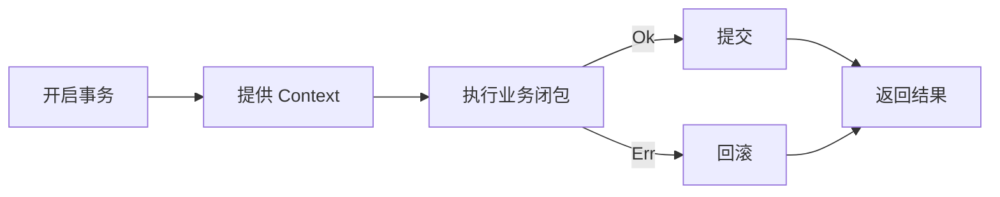

<div class="eyebrow">RUST · ARCHITECTURE · EXPLICIT CONTEXT</div>

# 事务上下文<br>如何优雅地注入？

<div class="subtitle">让业务决定边界，让类型系统连接依赖</div>

<div class="mt-12 muted">Lubover ·《优雅处理事务上下文注入的设计范式》配套解说</div>

<!--
开场，约 30 秒。今天讨论一个很具体的问题：当业务需要把两次数据库操作放进同一个事务，已有的 Repository 接口应该如何配合？我们会从最直觉的依赖注入开始，每一步只解决一个问题，最终得到文章中的 Nucl 协调器。代码是用于讲解接口关系的 Rust 示意，省略 import、具体数据库与错误定义。
-->

---

<div class="eyebrow">01 / THE PROBLEM</div>

# 一次转账，两次写入

<div class="columns">
<div class="card">
<div class="number">−100</div>
<h2>付款钱包</h2>
<p>debit_balance(sender, 100)</p>
<p class="muted">第一步：扣减余额</p>
</div>
<div class="card">
<div class="number">+100</div>
<h2>收款钱包</h2>
<p>credit_balance(receiver, 100)</p>
<p class="muted">第二步：增加余额</p>
</div>
</div>

<div v-click class="callout">如果扣款已经提交，而入账失败：<span class="danger">钱少了。</span></div>

<!--
约 40 秒。先让大家只看业务：从一个钱包转出一百，另一个钱包收到一百。点击揭示失败场景。按顺序 await 只能保证调用顺序；如果两次写入分别提交，第二次失败不会自动撤销第一次。这里需要数据库事务提供原子性。
-->

---

# 常见起点：给 service 注入一个 repo

```rust {all|1-3|5-6|all}
pub struct WalletRepoImpl {
    pool: ConnPool,
}

wallet_repo.debit_balance(sender_id, amount).await?;
wallet_repo.credit_balance(receiver_id, amount).await?;
```

<v-clicks>

- repo 自持连接池，调用方不用管理连接。
- 同一个 repo 实例可以服务多个 usecase。
- 但这个接口无法指定：**这两次调用参与同一个事务。**

</v-clicks>

<!--
约 50 秒。这是很自然的设计，普通查询或单次写入也确实方便。问题出现在业务临时想把一组操作组合起来时。不要假设一个 repo 实例就等于一个连接，更不要假设同一个实例的所有调用都会共享事务。这里的前提是还没有其他事务协调机制。
-->

---

# 事务的边界，只有业务知道


<div class="callout">service 决定<strong>哪些操作一起执行</strong>，repo 执行实际的数据访问。</div>

<p v-click class="muted">因此需要一条明确的路径，把当前事务的上下文传给 repo。</p>

<!--
约 40 秒。一个 usecase 可能只有中间两步需要事务。repo 单独看一次扣款，并不知道业务还要做一次入账。因此事务范围必须在业务组合的位置表达，而执行 SQL 的能力仍然留在 repo。接下来要设计的，就是两者之间的上下文传递路径。
-->

---

<div class="eyebrow">02 / MAKE CONTEXT EXPLICIT</div>

# 第一步：让 action 接受上下文

```rust {all|3|all}
async fn debit_balance(
    &self,
    context: Option<&mut Context>,
    wallet_id: i64,
    amount: i64,
) -> Result<(), BaseError>;
```

<div class="columns mt-7">
<div class="card"><h2>None</h2><p>repo 按普通路径获取连接</p></div>
<div class="card"><h2>Some(context)</h2><p>repo 使用调用方传入的上下文</p></div>
</div>

<!--
约 50 秒。用可选参数表达两条执行路径，就不必给每个 action 都写一个事务版本。Context 通常承载预先开启事务的连接，但名字保持通用，因为具体驱动的建模方式可能不同。单纯传一个布尔值只能表达意图，不能标识应该使用哪一个事务资源。
-->

---

# 但是，谁知道 Context 是什么？

```rust
// 如果 Context 是一个具体数据库类型……
let context = build_transaction_context().await?;
wallet_repo
    .debit_balance(Some(context), sender_id, amount)
    .await?;
```

<v-clicks>

- service 开始接触数据库上下文的具体类型。
- 自己构造上下文，还会接触事务的创建方式。

</v-clicks>

<div v-click class="callout">需要分别解决：<strong>隐藏具体类型</strong>，以及<strong>交出构造职责</strong>。</div>

<!--
约 40 秒。上一步补上了传递通道，却还没有守住抽象边界。这里有两个独立问题：签名里的具体类型是谁决定的，以及事务对象由谁构造。先处理类型，再处理生命周期，不要试图一次把所有东西都塞进 service。
-->

---

<div class="eyebrow">03 / ASSOCIATE THE TYPE</div>

# 第二步：让实现者决定 Context

```rust {all|3|7|all}
#[async_trait(?Send)]
pub trait WalletRepo {
    type Context;

    async fn debit_balance(
        &self,
        context: Option<&mut Self::Context>,
        wallet_id: i64,
        amount: i64,
    ) -> Result<(), BaseError>;

    // credit_balance 使用相同的 Self::Context
}
```

<div class="callout">对一个确定的 repo 实现，所接受的上下文类型也随之确定。</div>

<!--
约 55 秒。关联类型表达了实现者与上下文类型的关系。在 trait 内必须用 Self::Context 引用这个关联类型。这里没有给它增加数据库相关约束，因为业务层不需要操作连接，只需要把它继续传下去。async_trait 的问号 Send 沿用文章设定，这里没有宣称这些 future 可以跨线程调度。
-->

---

# service 只需知道：它叫 C

```rust {all|1-2|4|all}
pub async fn transfer_balance<C>(
    wallet_repo: &dyn WalletRepo<Context = C>,
    // sender_id、receiver_id、amount 等业务参数
) /* ... */
```

<div class="three mt-8">
<div class="card"><h2>知道</h2><p>repo 接受类型为 C 的上下文</p></div>
<div class="card"><h2>无需知道</h2><p>C 对应哪个驱动、连接或事务对象</p></div>
<div class="card"><h2>尚未解决</h2><p>谁创建 C，谁提交与回滚？</p></div>
</div>

<!--
约 40 秒。service 对 C 保持泛型，它知道类型关系，却不用知道具体表示。这里用借用的 trait object 简化展示；文章中的 Arc 同样可以保留。关联类型隐藏了实现细节，但不会凭空生成一个 C，所以下一步需要注入一个能提供上下文的能力。
-->

---

<div class="eyebrow">04 / COORDINATE THE LIFECYCLE</div>

# 第三步：引入事务协调器 Nucl

```rust {all|3-4|6-7|9-10|all}
#[async_trait(?Send)]
pub trait Nucl {
    type Context;
    type Error;

    async fn coord<F, T, E>(&self, f: F)
        -> Result<T, NuclError<E, Self::Error>>
    where
        F: for<'cx> AsyncFnOnce(&'cx mut Self::Context)
            -> Result<T, E>;
}
```

<div class="callout">协调器提供上下文，业务闭包在受控的范围内借用它。</div>

<!--
约 70 秒。Nucl 同样声明关联类型 Context，因此它能和 repo 建立编译期的类型关系。coord 接受异步闭包，并把可变借用交给闭包。for<'cx> 表达对借用生命周期的通用要求，允许闭包在 await 期间借用上下文。T 是成功结果，E 是操作错误，Self::Error 是事务后端错误。这是接口示意，不是某个 ORM 的现成适配。
-->

---

# 生命周期有了统一的归属



```rust
pub enum NuclError<E, BE> {
    Step(E),      // 业务闭包返回的操作错误
    Backend(BE),  // 开启、提交、回滚时的后端错误
}
```

<p class="muted">回滚失败时如何保留原始错误，以及异步取消如何清理资源，需由具体实现约定。</p>

<!--
约 55 秒。正常成功路径会提交，操作失败路径会尝试回滚，事务管理自身也可能失败。图展示的是控制流程，不能把提交或回滚画成必然成功。这个简单错误枚举还没有表达“操作失败并且回滚失败”的双重信息，具体实现要明确策略。future 被取消时，闭包也未必会走到返回 Err 的分支，因此清理机制仍是协调器实现必须承担的责任。
-->

---

# 两个 Context = C，连接两端

<div class="formula"><span class="accent">N::Context</span> = C = <span class="accent">WalletRepo::Context</span></div>

```rust
N: Nucl<Context = C>
wallet_repo: &dyn WalletRepo<Context = C>
```

<div class="columns mt-7">
<div class="card"><h2>编译期</h2><p>检查提供者与消费者的上下文类型一致</p></div>
<div class="card"><h2>运行时</h2><p>协调器创建资源，service 传递同一个上下文</p></div>
</div>

<!--
约 50 秒。这是全文的关键等式。Nucl 能提供什么，repo 能接收什么，通过同一个 C 连接。注意类型相等证明的是兼容性；真正让两次操作参与同一个事务，还需要运行时传递同一份上下文，并且 repo 实现正确使用它。类型系统本身不会验证 SQL 行为。
-->

---

# 最终的转账 usecase

```rust {all|1-7|8-14|9-12|all}
pub async fn transfer_balance<N, C>(
    nucl: &N,
    repo: &dyn WalletRepo<Context = C>,
    sender: i64, receiver: i64, amount: i64,
) -> Result<(), NuclError<BaseError, N::Error>>
where
    N: Nucl<Context = C>,
{
    nucl.coord(async move |cx| {
        repo.debit_balance(Some(&mut *cx), sender, amount).await?;
        repo.credit_balance(Some(&mut *cx), receiver, amount).await?;
        Ok::<(), BaseError>(())
    })
    .await
}
```

<p class="muted">两次顺序调用重借用同一个 cx；事务错误由返回类型显式保留。</p>

<!--
约 80 秒。先看签名上的两个 Context 等式，再看闭包划定的范围。Some 对应前面设计的可选上下文接口，&mut *cx 是明确的可变重借用，避免把可变引用直接移走。两次调用按顺序 await。闭包最后显式返回 Ok，外层保留 NuclError，避免依赖尚未定义的错误转换。这些细节是对文章示意代码的补全。代码仍需结合具体 trait、宏和后端实现使用。
-->

---

# 同一个 repo，可以切换执行范围

```rust {all|1-2|4-8|10-11|all}
// 普通调用：由 repo 选择普通执行路径
repo.debit_balance(None, fee_wallet, fee).await?;

nucl.coord(async |cx| {
    repo.debit_balance(Some(&mut *cx), sender, amount).await?;
    repo.credit_balance(Some(&mut *cx), receiver, amount).await?;
    Ok::<(), BaseError>(())
}).await?;

// 之后可以继续进行普通调用
repo.credit_balance(None, reward_wallet, reward).await?;
```

<div class="callout">事务范围由闭包表达；每一次 action 的执行上下文由参数表达。</div>

<!--
约 45 秒。这页是调用片段，外层错误转换省略。手续费和奖励这里只用于展示局部事务的形态，不是对转账业务规则的建议。事务外的操作不会随中间事务一起回滚，实际边界必须由业务需求决定。关键是共享的 repo 不需要存一个“当前事务”的可变开关，上下文属于每一次调用。
-->

---

<div class="eyebrow">05 / RESPONSIBILITIES</div>

# 三个角色，各自掌握必要的信息

<div class="three mt-10">
<div class="card"><div class="number">01</div><h2>Nucl</h2><p>提供事务上下文</p><p class="muted">创建 · 提交 · 回滚<br>资源与取消处理</p></div>
<div class="card"><div class="number">02</div><h2>service</h2><p>组合业务操作</p><p class="muted">划定边界<br>传递上下文</p></div>
<div class="card"><div class="number">03</div><h2>repo</h2><p>消费执行上下文</p><p class="muted">使用传入资源<br>执行数据访问</p></div>
</div>

<div class="callout">service 依赖能力与类型关系；数据库细节留在具体实现中。</div>

<!--
约 45 秒。回到一开始的目标：让业务控制事务边界，同时不让连接池和数据库类型向上泄漏。现在每个角色都有明确的责任。协调器和 repo 的实现仍然要知道具体数据库，但 service 可以在抽象层把它们组合起来。
-->

---

# 类型系统保证到哪里？

| 设计中的约束 | 实际含义 |
| --- | --- |
| 两侧 `Context = C` | 提供与接收的类型匹配 |
| `&mut C` 与借用范围 | 访问受 Rust 借用规则约束 |
| repo 使用传入的 `C` | 需要具体实现遵守接口语义 |
| 正确提交、回滚和取消清理 | 需要协调器与后端实现保障 |
| 隔离级别、重试与嵌套事务 | 需要额外设计 |

<p class="muted">同一类型的两个上下文，也可能来自不同连接或不同数据库实例。</p>

<!--
约 50 秒。讲静态类型安全时需要精确。我们证明了类型兼容和借用关系，并没有仅靠一个 C 就证明数据库语义全部正确。哪一个池创建了资源、repo 是否误用自己的池、取消时是否完成清理，都仍然要靠实现。本文给出的是组织这些责任的接口基础。
-->

---

# 为什么 Spring 中往往感觉不到这个问题？

<div class="columns mt-8">
<div class="card"><h2>常见命令式事务模型</h2><p>事务资源绑定到当前线程。</p><p>数据访问组件通过框架机制取得资源。</p></div>
<div class="card"><h2>本文的显式模型</h2><p>上下文沿函数参数传递。</p><p>关联类型在接口中表达匹配关系。</p></div>
</div>

<div class="callout">两种方式把事务参与关系放在不同位置：运行时协调机制，或显式接口。</div>

<p class="muted">这里特指常见的命令式 JDBC 场景；函数签名未表达关系，不等于事务不可靠。</p>

<!--
约 45 秒。这是文章题外话的简短回答。Spring 的事务感知组件会取出框架绑定的连接，所以 service 无需每次传参。本文关注另一种取舍：把关系放进接口和借用里。不要把静态接口不表达事务关系扩大为框架不具备可靠的事务机制，也不要把线程绑定的描述推广到所有响应式场景。
-->

---

# 从这套接口继续向前

<v-clicks>

- 将操作进一步抽象为 action，增强组合与复用。
- 将隔离级别要求加入类型关系。
- 探索普通与事务路径的编译期分发。

</v-clicks>

<div class="columns mt-8">
<div class="card"><h2>事务框架</h2><p><a href="https://github.com/poprako-dev/poprako-orchestra">poprako-orchestra ↗</a></p></div>
<div class="card"><h2>业务服务器</h2><p><a href="https://github.com/poprako-dev/poprako-server">poprako-server ↗</a></p></div>
</div>

<!--
约 40 秒。以上是文章提到的后续方向和实际项目。可选上下文会有运行时分支，但不能仅凭接口就断言它是性能瓶颈，是否值得静态分发还需要测量。这里的两个仓库链接来自原文，用于继续阅读；本次讲解没有审计它们的最新实现。
-->

---
layout: center
---

<div class="eyebrow">TAKEAWAY</div>

# 把事务上下文变成可传递的能力

<div class="closing">业务决定<strong>边界</strong><br>协调器提供<strong>上下文</strong><br>关联类型连接<strong>提供者与消费者</strong></div>

<p class="mt-10 muted">从一次钱包转账出发，得到可以复用的依赖注入关系。</p>

<!--
收尾，约 30 秒。可以再用一句话复述全过程：repo 原来只会从自己的池取连接；加入可选上下文后能接受外界资源；关联类型隐藏资源表示；Nucl 统一管理生命周期；service 用同一个 C 把两端连接起来。问题讨论可以围绕多 repo 共享上下文、取消安全和隔离级别展开。
-->
