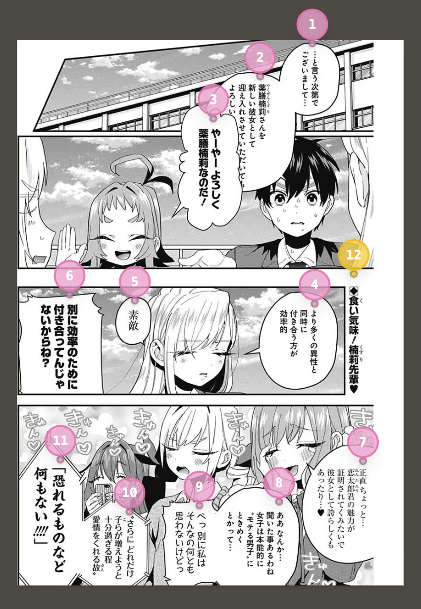

## 简述

在 PopRaKo 在线协同翻校子系统开发的过程中，如何处理每个 page 上的 unit 的并发修改，是一个无法绕过的核心问题。

一个看似简单的并发翻校问题，实际上牵扯到诸多建模、设计以及批处理的取舍。接下来我将会叙述一种相对简单，已经在白杨子中上线的 unit 并发处理设计。

---

## 业务场景建模

为了方便叙述，我们需要先对几个关键的概念进行建模。

### 建模 unit

一个 page 上的 unit 通常分布如下：



每个 unit 都有自己的坐标和翻译文本，所以可以先定义如下：

```rust
pub struct UnitInfo {
    pub x_coord: f64, // 取值范围：[0, 1]
    pub y_coord: f64, // 取值范围：[0, 1]

    pub translation: String, // 默认为 "" 空字符串
}
```

随后为了能够区分各个 unit 和快速查找，我们通常需要再添加一个 ID：

```rust ins={2}
pub struct UnitInfo {
    pub id: String,

    pub x_coord: f64,
    pub y_coord: f64,

    pub translation: String, // 默认为 "" 空字符串
}
```

### 建模 page （仅 unit 列表）

可以注意到，为了在翻校时有一个参考的阅读顺序，每个 unit 在图上有一个属于自己的序号。不过这个序号无需由 `UnitInfo` 自己承载，若我们将 page 上的 unit 列表建模为：

```rust {2}
pub struct PageDetail {
    pub unit_list: Vec<UnitInfo>,
    // ...
}
```

则每个 unit 的序号自然就是它在 `Vec` 中的索引 + 1。

### 建模客户端行为及编辑 operation

由于 PopRaKo 采用 C-S 架构，所以服务器与客户端之间需要定义业务层协议。具体到 unit 编辑上，就是要定义客户端如何拉取服务端 `unit_list`，以及如何通知服务器要进行哪些修改。

先忽略一切通信延迟，也先不考虑并发，我们可以选择如下方式来进行服务器与客户端的同步：

1. 客户端拉取服务器的 `unit_list` 并保存为本地 `local_unit_list` snapshot。
2. 客户端进行修改，生成一个 edit operation。
3. 客户端提交 operation 请求，服务器将 operation **尝试性** 地 merge 到 `unit_list`。
4. 如果服务器 merge 成功，则下发最新的 `unit_list`，客户端更新 snapshot。

基于这种建模，剩余问题缩小到客户端提交的 operation 包括什么。

不难注意到，实际上客户端会做的操作包括四种：

- 创建新 unit
- 修改既有 unit 的部分字段
- 删除既有 unit
- 移动 unit

以 usecase 层的 Rust 代码为例，他们可以对应如下的一个 enum 以及处理函数：

```rust
pub enum EditUnitsOperation {
    Create {
        x_coord: f64,
        y_coord: f64,
        index: usize,
        translation: Option<String>,
    },
    Patch {
        id: String,
        x_coord: Option<f64>,
        y_coord: Option<f64>,
        translation: Option<String>,
    },
    Delete {
        id: String,
    },
    Move {
        id: String,
        index: usize,
    }
}

impl PageDetail {
    pub fn edit_units(&mut self, operation: EditUnitsOperation) -> Result<Vec<UnitInfo>, BaseError> {
        // ...
    }
}
```

:::note
注意，所有 Rust 代码仅作示意，不代表真实实现就是如此。

本文不会给出四种 operation 的具体实现方式，但是可以简单说明逻辑：

- create：服务器赋予新 unit 一个权威 ID 然后插入数据库
- patch：部分更新既有 unit
- delete：*删除* 既有 unit
- move：先将目标 unit 从 `unit_list` 当中删除，然后再插入到指定位置
:::

## 合法 operation 及其 sequence 的定义

由于后续我们需要一步步挖掘现在方案的问题，以不断接近最终解决方案，所以我们需要先明确问题的边界，也就是 “**合法 operation**“ 的定义。

之所以要定义合法 operation，是因为它决定了一个 operation 能否和一个 `unit_list` 相兼容。下文的讨论将会讨论并发是如何破坏这些合法性的。

### 引用合法性

显而易见的约束：任何 operation 都必须引用服务器 `unit_list` 存在的 unit。

### 坐标合法性

每一个 unit 的 `x_coord` 和 `y_coord` 都是 `[0, 1]` 之间的浮点数。它代表的是这个标记的相对坐标，与 page 对应的图源 image 像素长宽无关。

### 序号合法性

每个 unit 在 `unit_list` 中由从 1 开始不重不漏的序号标识，这是一个强得多的合法边界约束字段。

首先我们需要判断哪些 operation 可能改变序号。`EditUnitsOperation` 的变体中，`Create`、`Delete` 和 `Move` 都有可能能改变某些 unit 的序号，比如：

- `Create`：在非末尾插入新 unit。
- `Delete`：在非末尾删除既有 unit。
- `Move`：任何情况下都有至少 2 个既有 unit 的序号改变。

再观察他们对应的 enum 的字段，可以发现 `Create` 和 `Move` 直接涉及到指定 `index`，而 `Delete` 则是隐式的。

对于 `Delete` 来说约束相对简单，在引用合法性约束下无需额外约束。

而对于 `Create`，必须保证 `index` 的范围是 `[1, unit_list.size() + 1]`。而 `Move` 则必须保证 `index` 的范围是 `[1, unit_list.size()]`。

### 合法 operation sequence

在定义了合法 operation 后，我们可以递归地定义 operation sequence 为：一个可以逐步、合法地 merge 到 `unit_list` 的 operation 组成的有序序列。

在下文中，我们总是假定客户端提交的 operation 是 **本地合法** 的（在自己的 snapshot 上 merge 是合法的）。

## 初始方案问题

经过上文的奠基，我们似乎已经拥有了一个完善的业务层协议，用来处理客户端和服务器之间的 `unit_list` 共识。

然而，正如开头所述，我们构建的协议是基于单客户端无并发的情况构筑的。因此，它无法适应我们希望协同编辑的并发目标。

接下来，我将会指出两个最核心问题，并依次修复它们，以演化出最终的方案。

###  依赖型 delete-patch 冲突

考虑服务器视角，它可能会接受到如下的一个非法 operation sequence：

```text {3}
初始 units 为：[a, b]
1. delete a => units 变为 [b]
2. patch a => a 不存在
```

但它是由如下的两个客户端各自合法的 operation 构造的：

```text {3}
1. 客户端 A、B 拉取到初始状态的 units
2. 客户端 A 删除了 a 并提交
3. 客户端 B 修改了 a 并提交
```

它的问题在于，修改同一 unit 的 delete 和 patch 形成了带有状态依赖的 delete-patch 序列。而因为 delete 会结束 unit 的生命周期，导致后续的 patch 引用垂悬，违反了引用合法性。

### index 失效

上述 delete-patch 冲突是基于对目标 unit 的直接依赖的，但是在我们现有的实现中，实际上也存在有因为对列表状态的间接依赖而导致的冲突，也就是 index 冲突。

考虑服务器接收到如下的非法 operation sequence：

```text {3}
初始 units 为：[a, b, c, d]
1. delete(a) => [a, c, b, (d)]
2. move(b, 4) => units 中已经没有 4 这个位置了
```

这同样也是多客户端并发时才会遇到的场景，比如对应：

```text {3}
1. 客户端 A、B 拉取到初始状态的 units
2. 客户端 A 删除了 a 并提交
3. 客户端 B 移动了 b 并提交
```

其核心原因是，序号实际上是一个依赖列表整体状态的属性，一个 unit 的序号改变，有可能导致其他的 unit 的序号发生改变，导致多个 operation 虽然没有作用于同一个 unit，却产生了间接的状态依赖。

## 冲突修复

### 依赖型 delete-patch 冲突修复

我们先来修复第一个较为简单的问题。正如我在问题小节所述，它的问题是垂悬引用。

那么我们只要让 unit 的生命周期能够长到覆盖任何的后续操作即可，也就是让一个 unit 自诞生起就永远不会 “消失”。

那么怎么做到既不让 unit “消失”，也仍然支持 delete 这个操作呢？其实很简单，将原本的硬删除修改为软删除即可；服务器看到的 unit 列表包含被软删除的 unit，而下发给客户端的 `unit_list` 不包含软删除的 unit。

那么相应地，我们需要将对应的 `UnitInfo` 更新为：

```rust ins={9}
pub struct UnitInfo {
    pub id: String,

    pub x_coord: f64,
    pub y_coord: f64,

    pub translation: String,

    pub is_hidden: bool, // 默认为 false
}
```

并在服务端额外添加如下逻辑：

- 当 `is_hidden` 为 true 时，不下发给请求拉取的客户端。
- 接收到 delete 请求时，将对应的 unit 的 `is_hidden` 设置为 true。
- 被 hidden 的 unit 被 patch 时，根据 patch 修改该 unit 并重新设置为可见。
- 被 hidden 的 unit 被 move 时，重新设置为可见。

这里我们可以继续将被软删除的 unit 放在服务器的 `unit_list` 中，因为序号实际上是客户端显示时才需要的派生数据，服务器只需要维护相对位置，并保证给客户端下发的 unit 列表中不包含被删除的 unit 即可保证客户端的序号正确。

不过这会有一个新的小问题需要解决。当服务器采用了软删除 unit 和真实 unit 放在一个数组里的存储方式时，move 操作将不再能直接使用 `insert(pos: usize, unit: Unit)` 类似的方法了，而必须采用类似线性探测法的手段找到新建 unit 的具体数组下标。

:::note
另外一种推出软删除方案的思路是：

列举原子 operation 之间的依赖序列：

- create-patch
- create-delete
- patch-patch（可以压缩为一个 patch）
- patch-delete
- **delete-patch**

可以注意到，所有仅包含 create 和 patch 的操作是自洽的，不会出现冲突。因此可以考虑将 delete 修改为一种 patch，进而想到可以设计 delete 的底层实现为软删除。
:::

### index 失效修复

在问题小节中，我们说明了 index 这种非局部信息带来的状态依赖冲突将会导致合法 operation sequence 的范围缩小。如果我们不想要这样局限的限制呢？

非常幸运的是，上一节中的软删除机制已经为我们打好了地基：它消解了引用合法性的问题，让所有的客户端合法引用，一定也是服务器合法引用。

那么这个机制又会如何影响我们的 index 设计呢？

考虑到引用已经必然合法了，我们可以试着使用引用机制来实现 index。也就是通过保证引用合法，来让序号一定合法。

不难发现，使用 “引用” 来表达次序，这正是 **链表** 的思路。我们可以只记录 unit 之间的 **相对位置**，而不是直接赋予它全局的 index 属性；index 属性，是从相对位置这种 **局部信息** 自底向上衍生出来的，而不是从数组下标自顶向下赋予的。

这种对于目标位置描述思路的变化，可以指导我们修改 `unit_list`，以形成一个 **逻辑上** 的链表结构：

```rust ins={3} del={2}
pub struct PageDetail {
    pub unit_list: Vec<UnitInfo>,
    pub unit_list: LinkedList<UnitInfo>,
    // ...
}
```

同时修改 `EditUnitsOperation`：

```rust del={5,20} ins={6,21}
pub enum EditUnitsOperation {
    Create {
        x_coord: f64,
        y_coord: f64,
        index: usize,
        prev_unit_id: Option<String>, // None 代表头插
        translation: Option<String>,
    },
    Patch {
        id: String,
        x_coord: Option<f64>,
        y_coord: Option<f64>,
        translation: Option<String>,
    },
    Delete {
        id: String,
    },
    Move {
        id: String,
        index: usize,
        prev_unit_id: Option<String>, // None 代表移动到开头
    }
}
```

这样，所有的 `index: usize` 就会被修改为 `prev_unit_id: Option<String>` 引用。

它的核心逻辑是：`index` 的 `usize` 类型它所代表的位置是易变的、可能非法的（客户端和服务器可能存在视图不一致），而 `prev_unit_id` 则通过引用合法性（客户端和服务器可以达成一致）保证了目标位置必然存在，从而缩小了值域，排除了非法取值。

目标位置的身份从一个可能失效的 index 身上解放出来，转而使用由软删除保证稳定的 unit 锚点。它同时消解了之前存在的非局部状态依赖，让 create、delete 和 move 的全局的 O(n) 影响变为了局部的 O(1)。

:::note
需要注意的是，create、delete 和 move 的序号影响仍然不是完全的只影响目标 unit，最多可能额外影响一个 unit（双向链表则是前后两个 unit）。
:::

### 修复小结

经过上文的两个修复，我们现在实际上已经将合法 operation 及 operation sequence 的约束降到了最低：只要满足引用合法性，该 operation（sequence）就一定是合法的。

这就代表着，只要客户端提交的是基于本地视图 `local_unit_list` 合法的 operation（sequence），就一定可以 merge 到服务器。这是一个非常强的保证，其将在下文展现它的用处。

## 批处理优化

在解决了单 operation 提交的正确性之后，我们还需要解决一些工程上的问题。我们在最开头假定了通信延迟为 0，所以没有考虑性能上的瓶颈，然而这种假设在现实中并不存在，所以我们不得不思考通信时延所带来的问题。

### 性能痛点

在开头所设计的协议中，客户端总是没生成一个 operation，就立刻提交并让服务器下发最新的 `unit_list` 。然而，在正常的翻校中，每一个 page 上客户端都会产生至少上百个 operation，如果每个都走一遍完整的请求-拉取，将会显著影响前端的编辑流畅度。

此外，虽然本文不会深入探讨接口层之下，usecase 层与 repository 层交互的细节，但是上文所描述的链表化设计，会导致业务逻辑中实际上会开启事务并持有锁，在成百上千次的请求下，也会导致 overhead 非常严重。

因此，我们必须引入批处理，以均摊请求-拉取过程中的代价。

### 批处理

我们之前已经证明，满足引用合法性的 operation（sequence）必然可以 merge 入服务器。这就代表着，我们可以直接将服务器的 edit_units 接口从单数修改为复数：

```rust del={2} ins={3}
impl PageDetail {
    pub fn edit_units(&mut self, operation: EditUnitsOperation) -> Result<Vec<UnitInfo>, BaseError> {
    pub fn edit_units(&mut self, operations: Vec<EditUnitsOperation>) -> Result<Vec<UnitInfo>, BaseError> {
        // ...
    }
}
```

这样，客户端可以按照自己的实际情况，积累一批 operations 等到合适的时机提交，将其开销从原本的 O(n) 降为 O(1)。

需要注意的是，采用批处理之后，一个批次提交的 operation sequence 中可能包含多个 create，并且后续 operation 可能依赖不同的新建 unit，所以 `Create` 变体需要更新字段：

```rust ins={3}
pub enum EditUnitsOperation {
    Create {
        local_id: String,
        x_coord: f64,
        y_coord: f64,
        index: usize,
        prev_unit_id: Option<String>,
        translation: Option<String>,
    },
    // ...
}
```

后续的 operation 就可以像引用服务器权威 ID 一样引用它。服务器在 `edit_units` 中会先为每个新 unit 赋予权威 ID，然后通过一个 map 来完成 local_id -> server_id 的翻译。

### operation 压缩

不难发现，实际上对于一个 operation sequence，其中非常多的 operation 都有着直接或间接的依赖关系，进而可以发生压缩。

比如：

- 对一个 unit 的多次 patch 可以合并为一次：`[patch(a), patch(a), patch(a)] => [patch(a)]`
- create-patch 型操作可以合并为一次 create：`[create(a), patch(a)] => [create(a)]`
- 一个 delete 可以清空之前的所有 patch（若是本地 create 甚至可以全部清空）：`[create(a), delete(a)] => []`

限于篇幅，着重于接口层设计的本文不作展开。

:::note
需要注意的是，create 创建的 unit 在本地暂存时通常需要 `local_id` 字段标识，一些引用了这个字段的 unit 相关编辑逻辑是需要特调的。
:::

### 幂等消费

采用批处理后，之前在理想单 operation 场景中搁置的重试问题就必须提上日程了。因为单 operation 发生非幂等重试其破坏性尚且可控，但一旦一整批 operations 发生重试，那么其影响面将会及其地不可预测。

一个简单的实现方式是，采用基于 token 的幂等消费机制：每次客户端提交 operation sequence 时，均绑定携带一个本地产生的类 UUID token，客户端因为失败重试时携带相同 token；服务器在消费成功时原子地记录该 token，以备客户端因为响应丢失重试。

不过需要注意的是，这个方案的可行性本身也是建立在批处理大幅降低了保存频次的情况下的。否则每次 operation 都记录一个 token 对数据库将是沉重的负担。

:::tip
在 PopRaKo 初期没有幂等重试机制时，就出现过客户端与服务端连接不稳定导致重复保存，最终形成了两倍 unit 的情况（因为翻译的工作流程一般是先 create 所有标记，然后再回头来 patch 具体的 translation；该轮的所有 create 都被重放了）。
:::

## 实时交互方案

读者可能有疑惑，既然这种基于 snapshot 的方案这么复杂，为什么最开始就采用实时方案，这样就不会有冲突问题了。

先暂且不论实时方案（基于 SSE 或者 WebSocket）需要额外设计哪些复杂的协议，又需要多稳定的网络链路，实际上最开始的理想协议就已经类似实时协议了：客户端每次操作前都拉取最新版本，并且修改立刻提交，只是没有实时下发功能。

但是关键的竞态问题依旧不会自然被解决，比如：

```text {4}
客户端 A、B 同时拉取到了初始状态的 unit_list
1. 客户端 A 发送了一个 operation
2. 服务器处理完成，准备广播给客户端 B
3. 在服务器下发变更消息到达客户端 B 之前，客户端 B 提交了一个与客户端 A 操作不兼容的 operation
```

在这个非理想场景中，依然会出现冲突窗口。所以我们必须要从 merge 策略本身下手进行改进，以让其能够兼容尽可能多的情况。

当然，在使用了改进后的 merge 策略协议后，实时方案自然也不会因为这个竞态窗口而发生冲突。但是既然都不会出现冲突、使用的是一个方案，为什么不采用设计更简单、性能更高、部署要求更低的非实时方案呢？

## 总结

经过上述设计，我们就完成了对 unit 编辑的接口逻辑设计，实现了从解决冲突到性能优化的全流程。

不过在 PopRaKo 的具体实现中，还有非常多的验证与优化没有说到，而这些逻辑需要在服务器与数据库的交互层进行，限于篇幅本文不再展开。具体逻辑可以参考 `poprako-server` 仓库的 `usecase` 和 `complex` 代码实现。

::github{repo="poprako-dev/poprako-server"}

## 题外话：Sequence CRDT RGA 与 unit 应用算法的相似性

读到这里，了解过协同编辑的读者可能会想到 RGA。它是一种处理有序序列的 CRDT，通常可以用于文本协同编辑。虽然本文处理的是 unit 而不是字符，但是两者在表达位置和处理删除时，确实有一些相似的思路。

具体来说，我们前面用了两个关键设计：

- 通过已有 unit 的 ID 表达插入位置，而不是依赖容易变化的 index。
- 删除时保留 unit，让后续引用它的 operation 仍然能够找到目标。

RGA 也采用了类似的设计。被删除的元素会留下一个 tombstone，也就是不再展示、但仍然保留的节点。这样，即使某个元素已经被删除，其他客户端基于旧视图提交的插入操作，仍然可以用它来定位。感兴趣的读者可以参考 [CRDT 综述中的 RGA 小节（3.5.1）](https://pages.lip6.fr/Marc.Shapiro/papers/Comprehensive-CRDTs-RR7506-2011-01.pdf)。

不过，思路相似并不代表本文实现了 RGA。RGA 还需要处理不同副本之间的一致性：在满足操作依赖的前提下，即使并发操作到达各个副本的顺序不同，应用相同的一组操作后，各个副本也应该得到相同的结果。因此，当多个客户端都往同一个元素后面插入时，RGA 需要有统一的排序规则。

而 PopRaKo 的情况要简单一些。客户端最终以服务器下发的 `unit_list` 为准，服务器负责确定 operation 的执行顺序。比如先 delete 再 patch 会恢复 unit，而先 patch 再 delete 则会隐藏它，我们允许这两种顺序得到不同结果。
